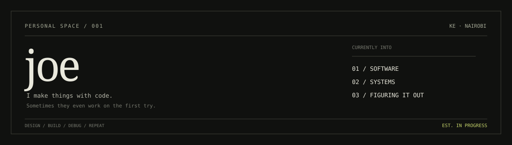
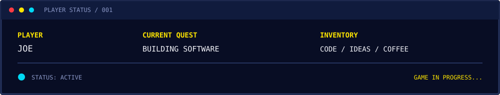

<div align="center">



<br>

<sub>PLAYER 01 &nbsp; / &nbsp; JOSEPH250-CODE &nbsp; / &nbsp; NAIROBI, KE</sub>

# JOE'S ARCADE

**I build software. I solve problems. I collect bugs.**

[GitHub](https://github.com/Joseph250-code) &nbsp; · &nbsp; [LinkedIn](https://linkedin.com/in/joseph-mbugua-6750262a1) &nbsp; · &nbsp; [Afya Smart V2](https://github.com/Joseph250-code/afya-smart-v2)

</div>

---

### 

### `01` &nbsp; PLAYER PROFILE

```text
PLAYER       JOE
LOCATION     NAIROBI, KENYA
CLASS        SOFTWARE DEVELOPER
CURRENT MAP  FULL-STACK DEVELOPMENT
STATUS       EXPLORING / BUILDING / DEBUGGING
```

I enjoy building software that does something useful. Most of my time goes into figuring out how different parts of a system fit together, from the interface to the database behind it.

Currently exploring backend development, frontend engineering, APIs, databases and system design.

---

### `02` &nbsp; CURRENT QUEST

<div align="center">

<a href="https://github.com/Joseph250-code/afya-smart-v2">

</a>

</div>

**AFYA SMART V2**

A multi-hospital digital healthcare platform connecting patient registration, appointments, medical records, prescriptions, laboratory services, pharmacy, billing and payments.

The challenge is making all those pieces work together as one system.

**Tech used**

`React` `JavaScript` `Flask` `Python` `Supabase` `PostgreSQL`

[Explore the repository →](https://github.com/Joseph250-code/afya-smart-v2)

---

### `03` &nbsp; INVENTORY / TOOLBOX

<div align="center">


</div>

---

### `04` &nbsp; THE HIGH SCORE TABLE

<div align="center">


</div>

---

### `05` &nbsp; THE ARCADE

<div align="center">

**THE CONTRIBUTION MAZE**

*Every commit moves the game forward.*

<picture>
  <source media="(prefers-color-scheme: dark)" srcset="https://raw.githubusercontent.com/Joseph250-code/Joseph250-code/output/pacman-contribution-graph-dark.svg">
  <source media="(prefers-color-scheme: light)" srcset="https://raw.githubusercontent.com/Joseph250-code/Joseph250-code/output/pacman-contribution-graph.svg">
  
</picture>

</div>

---

<div align="center">


<br><br>

<sub>GAME NOT OVER. JUST ANOTHER COMMIT.</sub>

</div>
